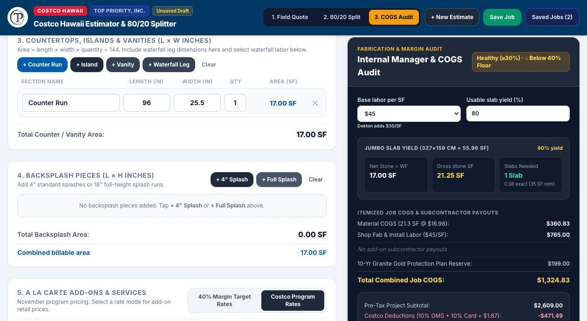

# TPI Costco Hawaii Master Estimator

**[Open the live estimator](https://kellytpi.github.io/MasterCalculator/)** · [Download the app](https://github.com/KellyTPI/MasterCalculator/archive/refs/heads/main.zip) · [Contributor setup](#working-on-the-estimator)

Top Priority, Inc. uses this calculator to prepare a Costco member’s countertop quote, enter the Centah and ActionFlow payment split, and check what the job earns after material, labor and subcontractor costs.

## Prepare a member quote

1. Choose **+ New Estimate** or open an existing job through **Saved Jobs → Load Estimate**. To try changes to a saved job while keeping the original, choose **Duplicate** and load the copy.
2. In **1. Field Quote**, enter the project details, material and edge profile. **Live Color Search** filters the choices. Select a color from the dropdown to apply it to the quote. Add each counter or backsplash piece, then enter its dimensions in **inches** and its quantity in whole pieces. A new estimate starts at zero square feet.
3. Add cutouts, demolition, custom work, protection and any pre-tax discount that applies. For a new waterfall, enter the stone under **+ Waterfall Leg** and select the waterfall labor under add-ons.
4. Review the member total and both payments. **Save Job** keeps the estimate in this browser. **Copy Customer Quote** and **Print / PDF** give the member the quote.

New estimates use the November 2026 installed rates of **$130, $150, $175 and $205 per square foot** for Tiers 1 through 4. Estimates reopened from the original calculator keep their original pricing schedule and waterfall allowance.

## Review an estimate in the office

| Open this view | Review or change | Read the result |
| --- | --- | --- |
| **2. 80/20 Split** | Confirm the final contract total including tax. Enter extra direct TPI charges and their costs. **Sync Field Quote** clears an office override. | Enter the 80% Costco payment in **Centah** and the 20% TPI balance plus applicable direct charges in **ActionFlow**. An office override applies to this settlement. The member’s Field Quote still uses the measured scope. |
| **3. COGS Audit** | Set base labor per square foot and **usable slab yield (40%–100%)**. Enter subcontractor costs in the custom lines when needed. | Check gross stone area, estimated slabs, itemized job costs, profit and margin. The slab count is based on area. Use the cutting layout to confirm what will fit. |



In the example, one **96 × 25.5 inch** counter measures **17.00 SF**. At **80% yield**, the audit allocates **21.25 SF** of material to the job.

### Correct an input

The current view stays open while you replace a number. If the entry is incomplete or out of range, the preview holds the last calculated figures and pauses saving, printing, copying and estimate-file exports. **Go to field** takes you to the entry, including an office field on another tab. For slab yield, finish typing a value such as **75.5** to update the audit.

## Save, share and reopen

| What you need | What to choose |
| --- | --- |
| **Return to a job on this device** | **Save Job**, then **Saved Jobs → Load Estimate** in the same browser. On a phone the buttons read **Save** and **Jobs**. Save again after editing. |
| **Give the member a quote** | **Field Quote → Print / PDF** for scope, total, payment schedule and signature block. **Copy Customer Quote** gives you text to paste. |
| **Print the office record** | **80/20 Split → Print Office Record / PDF** includes the quote, settlement and internal cost audit. |
| **Reopen an editable PDF** | **Field Quote → Save Editable PDF**. In **Saved Jobs**, choose **Open Estimate PDF** to reopen the draft. This file contains internal costs. |
| **Move one job to another device** | **Saved Jobs → Save Current Estimate (.json)**, then **Open Estimate (.json)** on the other device. Choose **Save Job** there to keep it. Single-job files from the November standalone calculator also open here. |
| **Back up the whole saved list** | **Saved Jobs → Export Backup (.json)**. **Import Backup (.json)** adds jobs and updates matching job IDs. Keep editable files and backups with office records. |

## Working on the estimator

GitHub Pages publishes `main`. For a local copy, extract the ZIP and open `index.html` with the `assets` folder alongside it. For development, start from the current repository.

```sh
git clone https://github.com/KellyTPI/MasterCalculator.git
cd MasterCalculator
node --test tests/estimate.test.cjs
```

For an existing clone, switch to `main` and run `git pull --ff-only` before branching. The calculation tests use Node’s built-in test runner.

**Quick pricing check.** Start a new Tier 1 estimate, add one 12 × 12 inch counter, and turn off protection. The expected subtotal is **$130.00**. The total with Hawaii GET is **$136.13**, split into **$108.90** and **$27.23**.

**Browser check.** With Chrome and the Playwright Node package available, run `node tests/editing.browser.cjs`. It checks keyboard editing, field navigation, quote actions and reopening a saved job at desktop and phone widths in a temporary browser profile. On macOS, you can install the test dependency outside the checkout.

```sh
npm install --prefix "${TMPDIR:-/tmp}/tpi-estimator-tests" playwright
NODE_PATH="${TMPDIR:-/tmp}/tpi-estimator-tests/node_modules" node tests/editing.browser.cjs
```

<details>
<summary><strong>Codex setup, model choices and a starter prompt</strong></summary>

Open **Codex** in the ChatGPT desktop app, sign in with the account that has Plus, and select the cloned **MasterCalculator** folder as your project. Choose a model and reasoning level in the Codex model selector. The available options depend on the account and workspace. [Using Codex with your ChatGPT plan](https://help.openai.com/en/articles/11369540-using-codex-with-your-chatgpt-plan)

| Suggested setting | When to use it on this project |
| --- | --- |
| **GPT-6.2 Sol · Medium** | Start here for everyday features, quote wording, layout changes and focused bug fixes. |
| **GPT-6.2 Sol · High** | Use for changes that span several workflows, such as a new field that must save, reopen and print correctly. |
| **GPT-6.2 Astra · Extra High** | Use when available for a difficult pricing discrepancy, a change to how older jobs load, or a substantial refactor. |

Higher reasoning levels take more time and use more of the account’s allowance. Choose the setting to fit the change. [OpenAI’s model and reasoning guide](https://learn.chatgpt.com/docs/models)

**A prompt to start a feature**

> Open the KellyTPI/MasterCalculator repository, fetch the latest main, and create a feature branch from it. Add [describe the change and what someone should see when it works]. Preserve existing estimates and quote math except where the request changes them. Run the estimator tests and try the affected workflow in a browser. Open a draft pull request with a short summary and steps I can use to check it.

</details>

For changes to saved data or printed output, reopen an older estimate and inspect the member quote and office record in print preview. Use sample jobs for shared screenshots. Review the pull request, merge it into `main`, then verify the affected workflow on the live site after the Pages deployment finishes.

| Source | Where to look |
| --- | --- |
| [Estimator](index.html) | Interface, pricing schedules, saved-job handling and `calculateEstimate`. |
| [Editable PDF handling](assets/estimate-pdf.js) | Creation and reopening of office work copies. The app bundles [pdf-lib 1.17.1](https://github.com/Hopding/pdf-lib/tree/v1.17.1) under the [MIT license](assets/pdf-lib-LICENSE.md). |
| [Calculation tests](tests/estimate.test.cjs) · [Browser editing tests](tests/editing.browser.cjs) | Pricing, payment rounding, historical estimates and field-editing regressions. |
| [Calculation audit](CALCULATION-AUDIT.md) | Worked examples, historical discrepancies and business assumptions to confirm against office records. |
